# Smart E-Waste Recycling Platform — Entity Relationship (ER) Model

## 1. Overview & 3NF Normalization
The database schema is strictly normalized to the Third Normal Form (3NF):
- **1NF**: All column values are atomic; repeating groups are eliminated.
- **2NF**: All non-key attributes are fully functionally dependent on the entire primary key (composite keys on junction tables like `center_accepted_categories` and `category_materials` contain only join attributes).
- **3NF**: Every non-key attribute depends *only* on the primary key, eliminating transitive dependencies (e.g., status change history is split into dedicated audit tables `center_status_history` and `record_status_history`).

---

## 2. Mermaid Entity Relationship Diagram

```mermaid
erDiagram
    ROLES ||--o{ USERS : "assigned to"
    USERS ||--o{ SESSIONS : "owns"
    USERS ||--o{ RECYCLING_CENTERS : "created/managed by"
    USERS ||--o{ RECYCLING_RECORDS : "submits"
    USERS ||--o{ POINTS_LEDGER : "accrues/spends"
    USERS ||--o{ REDEMPTIONS : "requests"
    USERS ||--o{ USER_BADGES : "earns"
    BADGES ||--o{ USER_BADGES : "awarded in"

    RECYCLING_CENTERS ||--o{ CENTER_ACCEPTED_CATEGORIES : "accepts"
    DEVICE_CATEGORIES ||--o{ CENTER_ACCEPTED_CATEGORIES : "handled by"
    DEVICE_CATEGORIES ||--o{ CATEGORY_MATERIALS : "composed of"
    MATERIALS ||--o{ CATEGORY_MATERIALS : "forms"

    RECYCLING_CENTERS ||--o{ CENTER_VERIFICATIONS : "undergoes"
    RECYCLING_CENTERS ||--o{ CENTER_STATUS_HISTORY : "tracks status"
    USERS ||--o{ CENTER_VERIFICATIONS : "reviewed by"

    DEVICE_CATEGORIES ||--o{ RECYCLING_RECORDS : "categorizes"
    RECYCLING_CENTERS ||--o{ RECYCLING_RECORDS : "received at"
    RECYCLING_RECORDS ||--o| RECEIPTS : "confirmed by"
    RECYCLING_RECORDS ||--o{ RECORD_STATUS_HISTORY : "tracks status"
    RECYCLING_RECORDS ||--o| POINTS_LEDGER : "awards points"

    REWARDS ||--o{ REDEMPTIONS : "redeemed via"

    ROLES {
        int role_id PK
        string role_name UK "admin, user, center_rep"
    }

    USERS {
        uuid id PK
        string email UK
        string password_hash
        string full_name
        int role_id FK
        string phone
        timestamp created_at
        timestamp updated_at
    }

    SESSIONS {
        string session_id PK "SHA-256 token"
        uuid user_id FK
        jsonb data
        timestamp expires_at
        timestamp created_at
    }

    DEVICE_CATEGORIES {
        uuid category_id PK
        string code UK "e.g. SMARTPHONE, LAPTOP"
        string name
        string handling_priority
        numeric points_per_kg
        int base_points
        boolean is_active
    }

    MATERIALS {
        uuid material_id PK
        string code UK "e.g. COPPER, GOLD, LITHIUM"
        string name
        string unit "kg, g"
        numeric recovery_rate_percentage
    }

    CATEGORY_MATERIALS {
        uuid category_id PK,FK
        uuid material_id PK,FK
        numeric estimated_weight_ratio
    }

    RECYCLING_CENTERS {
        uuid center_id PK
        string name
        text address
        string contact_phone
        string contact_email
        geometry location "Point 4326 PostGIS"
        string verification_status "pending, verified, rejected, expired"
        uuid created_by FK
        timestamp created_at
        timestamp updated_at
    }

    CENTER_ACCEPTED_CATEGORIES {
        uuid center_id PK,FK
        uuid category_id PK,FK
    }

    CENTER_VERIFICATIONS {
        uuid verification_id PK
        uuid center_id FK
        string status "pending, verified, rejected, expired"
        uuid reviewer_id FK
        date valid_from
        date valid_until
        text rejection_reason
        timestamp reviewed_at
        timestamp created_at
    }

    CENTER_STATUS_HISTORY {
        uuid history_id PK
        uuid center_id FK
        string old_status
        string new_status
        uuid changed_by FK
        text reason
        timestamp changed_at
    }

    RECYCLING_RECORDS {
        uuid record_id PK
        uuid user_id FK
        uuid center_id FK
        uuid category_id FK
        numeric weight_kg
        int estimated_units
        string status "pending, approved, rejected"
        uuid mongo_photo_id "Cross-DB UUID"
        timestamp created_at
        timestamp updated_at
    }

    RECEIPTS {
        uuid receipt_id PK
        uuid record_id UK,FK
        string receipt_number UK
        string verification_code UK
        uuid center_id FK
        date issued_date
        timestamp created_at
    }

    RECORD_STATUS_HISTORY {
        uuid history_id PK
        uuid record_id FK
        string old_status
        string new_status
        uuid changed_by FK
        text reason
        timestamp changed_at
    }

    POINTS_LEDGER {
        uuid ledger_id PK
        uuid user_id FK
        uuid record_id UK,FK "One award per record constraint"
        string transaction_type "recycling_award, reward_redemption, adjustment"
        int points "Signed integer"
        string idempotency_key UK
        text notes
        timestamp created_at
    }

    REWARDS {
        uuid reward_id PK
        string title
        text description
        int points_cost
        int stock_quantity
        boolean is_active
        timestamp created_at
        timestamp updated_at
    }

    REDEMPTIONS {
        uuid redemption_id PK
        uuid user_id FK
        uuid reward_id FK
        int points_spent
        string status "completed, cancelled"
        string idempotency_key UK
        timestamp redeemed_at
    }

    BADGES {
        uuid badge_id PK
        string code UK
        string name
        text description
        int required_points
        int required_records
    }

    USER_BADGES {
        uuid user_id PK,FK
        uuid badge_id PK,FK
        timestamp awarded_at
    }
```

---

## 3. Cross-Database Strategy (PostgreSQL + MongoDB)

### Why Two Databases?
1. **PostgreSQL + PostGIS**:
   - Manages relational domain logic, spatial proximity queries, financial-grade points ledger transactions, foreign key integrity, and audit logs.
2. **MongoDB**:
   - Manages unstructured and semi-structured artifacts: photo metadata, high-dimensional AI inference classifications, raw JSON telemetry, and vendor verification documents.

### Shared UUID Linking Strategy
- All entities generated in the system use **Version 4 UUIDs** (`gen_random_uuid()`).
- When a user uploads a device photo:
  1. The backend generates a shared `record_id` and `photo_id` UUID.
  2. The raw file is stored on the filesystem at `/uploads/<photo_id>.<ext>`.
  3. The `device_photo_metadata` and `ai_analysis_reports` are saved in MongoDB under `_id: photo_id` and `record_id: record_id`.
  4. The recycling record in PostgreSQL stores `record_id` and links `mongo_photo_id = photo_id`.
- Consistency Rule: **PostgreSQL is written first** in transactional workflows. MongoDB updates/metadata inserts follow with an idempotency key and retry mechanism.
